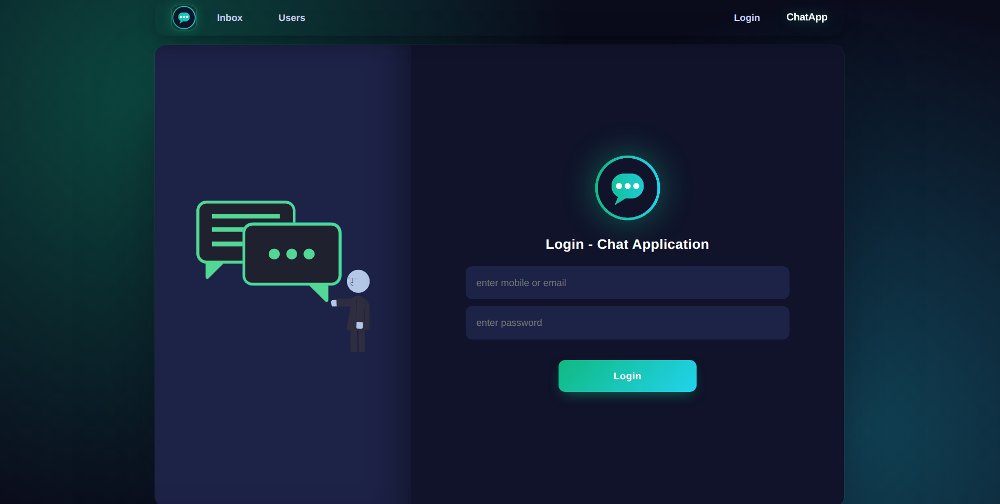
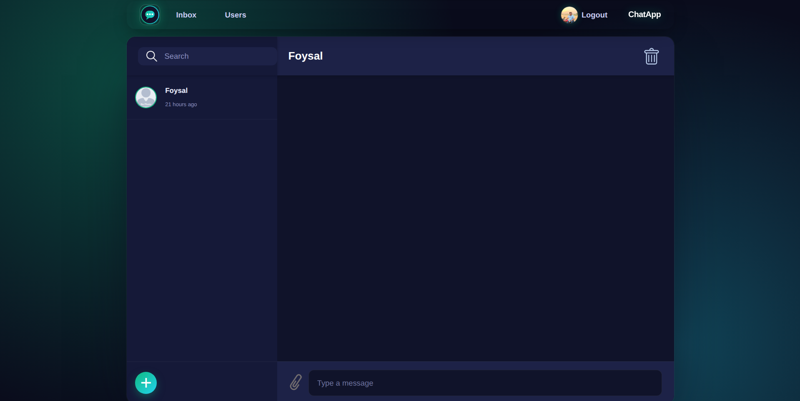
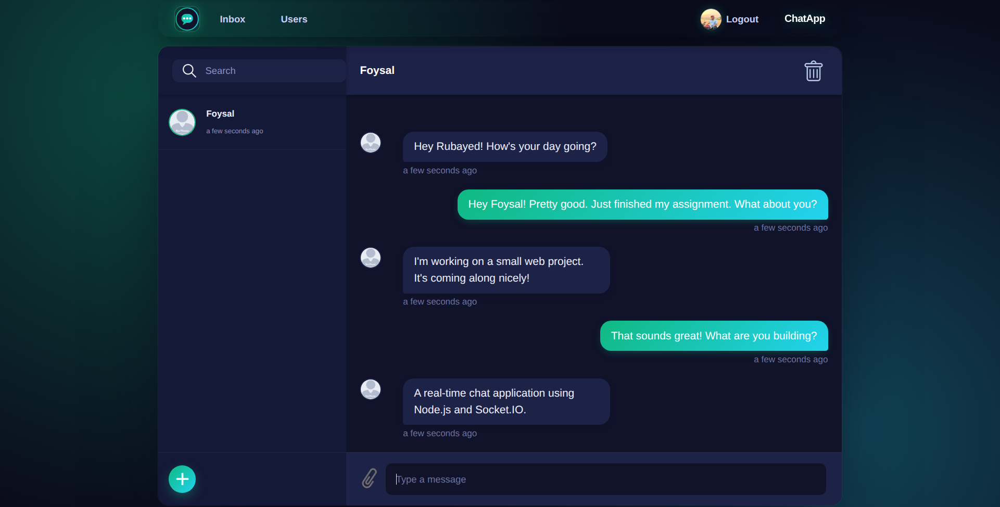
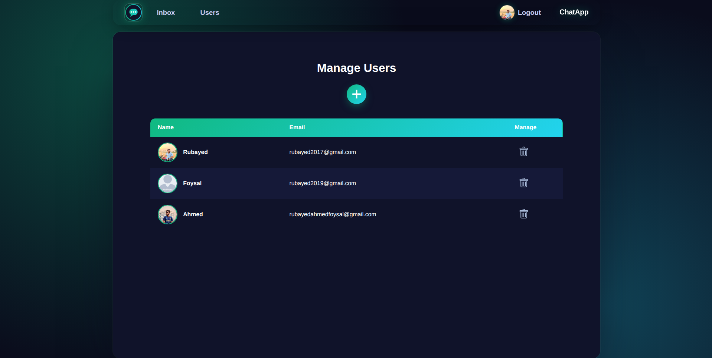

# Chat Application

A real-time one-to-one chat application built with **Node.js, TypeScript, Express, MongoDB, and Socket.IO**. It supports user authentication, conversation management, real-time messaging, typing indicators, file attachments, and admin-only user management.

## Features

### Authentication & Authorization
- Login using email or mobile number.
- Password hashing with Argon2.
- JWT-based authentication using signed, HTTP-only cookies.
- Role-based access control (`user` and `admin`).
- Middleware-based authentication and authorization.

### User Management
- Search users by name, email, or mobile number.
- Admin-only user creation and deletion.
- Upload user avatars.
- Avatars are stored on Cloudinary; validation runs before the upload so rejected registrations leave no orphaned assets.

### Conversations
- One-to-one conversations.
- Duplicate conversation prevention, regardless of participant order.
- Conversation search scoped to the authenticated user's conversations.
- Inbox sorted by the most recently updated conversation.
- Real-time conversation deletion for participants.

### Real-Time Messaging
- Real-time messaging with Socket.IO.
- Conversation-specific socket rooms.
- Typing indicators with debounce and automatic timeout.
- Message attachments.

### File Uploads
- Image, PDF, DOC, XLS, and TXT attachments.
- Maximum attachment size: 20 MB.
- JPG, JPEG, and PNG avatars.
- Maximum avatar size: 5 MB.
- Cloud storage via Cloudinary (Multer parses the request into memory, then files are streamed to Cloudinary).

## Tech Stack

| Category | Technology |
|---|---|
| Runtime | Node.js |
| Language | TypeScript |
| Backend | Express 5 |
| Database | MongoDB |
| ODM | Mongoose |
| Real-time Communication | Socket.IO |
| Authentication | JWT, Argon2 |
| Validation | express-validator |
| File Upload | Multer + Cloudinary |
| Template Engine | EJS |
| Frontend | Vanilla JavaScript, CSS |
| Notifications | Toastify |
| Date Formatting | Moment.js |

## Screenshots

Add your application screenshots to `docs/screenshots/`.

Recommended structure:

```text
docs/
└── screenshots/
    ├── Login.png
    ├── Inbox.png
    ├── Conversation.png
    └── User_manage.png
```

### Login



### Inbox



### Conversation



### User Management



## Requirements

Before running the project, make sure you have:

- Node.js
- npm
- MongoDB running locally or a MongoDB connection URI
- Git

## Getting Started

### 1. Clone the Repository

```bash
git clone <repository-url>
cd chat-application
```

### 2. Install Dependencies

```bash
npm install
```

### 3. Configure Environment Variables

Create a `.env` file in the project root:

```env
PORT=3000
Mongo_URI=mongodb://127.0.0.1:27017/chat_application
NODE_ENV=development

JWT_SECRET=your_jwt_secret
JWT_EXPIRATION=1d

COOKIE_NAME=token
COOKIE_MAX_AGE=86400000
COOKIE_SECRET=your_cookie_secret
```

Replace the placeholder secrets with your own secure values.

### 4. Run the Development Server

```bash
npm run dev
```

### 5. Build the Project

```bash
npm run build
```

### 6. Run the Production Build

```bash
npm start
```

### 7. Type Check

```bash
npm run typecheck
```

The application will be available at:

```text
http://localhost:3000
```

## Available Scripts

| Script | Description |
|---|---|
| `npm run dev` | Starts the development server with TypeScript watch mode |
| `npm run build` | Compiles TypeScript into JavaScript |
| `npm start` | Runs the compiled application |
| `npm run typecheck` | Checks TypeScript types without generating build files |

## Project Structure

```text
chat-application/
├── docs/
│   ├── screenshots/
│   ├── routes.md
│   ├── authentication.md
│   ├── authorization.md
│   ├── data-model.md
│   ├── socket.md
│   ├── search.md
│   ├── uploads.md
│   ├── inbox.md
│   ├── login.md
│   ├── users.md
│   └── *-router-flow.md
│
├── public/
│   ├── images/
│   ├── js/
│   └── stylesheets/
│
├── src/
│   ├── config/
│   │   ├── cloudinary.ts
│   │   └── env.ts
│   ├── controllers/
│   ├── middlewares/
│   ├── models/
│   ├── router/
│   ├── types/
│   │   └── express/
│   ├── utils/
│   ├── dbConnection.ts
│   ├── index.ts
│   └── socket.ts
│
├── views/
├── .env
├── .env.example
├── .gitignore
├── package.json
├── package-lock.json
└── tsconfig.json
```

## Architecture Overview

The application follows a modular backend structure.

- **Routes:** Define application endpoints and connect them to middleware and controllers.
- **Controllers:** Handle HTTP requests, application logic, and responses.
- **Models:** Define MongoDB schemas and database interactions using Mongoose.
- **Middlewares:** Handle authentication, authorization, validation, and request processing.
- **Socket:** Manages real-time communication between connected clients.
- **Utils:** Contains reusable helper functions.
- **Views:** Render application pages using EJS.
- **Public:** Contains frontend assets and uploaded files.

### Authentication Flow

1. A user submits their email or mobile number and password.
2. The server validates the credentials.
3. Argon2 verifies the submitted password against the stored hash.
4. The server generates a JWT.
5. The JWT is stored in a signed, HTTP-only cookie.
6. Authentication middleware verifies the token on protected requests.

### Middleware

The application uses different middleware for different authorization responsibilities:

- **Soft authentication:** Identifies the current user and populates `req.user` when authentication is available.
- **Hard authentication:** Requires a valid authenticated user.
- **Role authorization:** Restricts selected operations to users with the required role.
- **Conversation participant authorization:** Ensures users can access only conversations in which they participate.

### Real-Time Communication

Socket.IO handles real-time communication.

- Each conversation uses a separate room identified by its conversation ID.
- Connected clients join their conversation rooms.
- Messages and conversation deletion events are communicated in real time.
- Typing indicators use debouncing and automatically disappear after a timeout.

## Documentation

Detailed technical documentation is available in the `docs/` directory.

| Document | Description |
|---|---|
| [Routes](docs/routes.md) | Application routes and endpoints |
| [Authentication](docs/authentication.md) | Authentication implementation |
| [Authorization](docs/authorization.md) | Middleware and access control |
| [Data Model](docs/data-model.md) | MongoDB schemas and relationships |
| [Socket.IO](docs/socket.md) | Real-time communication |
| [Search](docs/search.md) | User and conversation search |
| [Uploads](docs/uploads.md) | File upload implementation |
| [Inbox](docs/inbox.md) | Conversation inbox functionality |
| [Login](docs/login.md) | Login implementation |
| [Users](docs/users.md) | User management |

Additional router-flow documentation is also available in the same directory.

## Known Limitations

The following features and improvements are not currently implemented:

- Only one-to-one conversations are supported.
- Messages cannot be edited or deleted.
- Read receipts are not implemented.
- Socket.IO connections do not have independent authentication.
- Socket room joining currently trusts the conversation ID supplied by the client.
- Password reset is not available.
- Email and mobile verification are not implemented.
- Rate limiting is not implemented.
- Remember-me functionality is not available.
- Logging out does not revoke the JWT server-side.
- Role changes require re-login because the role is included in the JWT.
- Avatars and attachments are stored on Cloudinary; the local `public/uploads` folder is no longer used.
- Message attachments are removed from Cloudinary when a conversation is deleted, but individual messages cannot be deleted.

## Future Improvements

Potential improvements for future development:

- Add group conversations.
- Implement message editing and deletion.
- Add message read receipts.
- Authenticate Socket.IO connections.
- Validate conversation membership before allowing socket room access.
- Implement password reset and account verification.
- Add rate limiting and stronger security controls.
- Add server-side JWT revocation or token rotation.
- Add a background job to prune orphaned Cloudinary assets.
- Add automated testing.

## Environment Variables

| Variable | Description |
|---|---|
| `PORT` | Server port |
| `Mongo_URI` | MongoDB connection URI |
| `NODE_ENV` | Application environment |
| `JWT_SECRET` | Secret used to sign JWTs |
| `JWT_EXPIRATION` | JWT expiration duration |
| `COOKIE_NAME` | Authentication cookie name |
| `COOKIE_MAX_AGE` | Cookie lifetime in milliseconds |
| `COOKIE_SECRET` | Secret used for cookie signing |
| `CLOUDINARY_URL` | Cloudinary credentials URL (`cloudinary://<api_key>:<api_secret>@<cloud_name>`) |

**Important:** Never commit your actual `.env` file. Keep secrets private and provide an `.env.example` file with placeholder values.

## Admin Setup

The application supports role-based access control.

To create the initial administrator, insert a user document directly into MongoDB with:

```json
{
  "role": "admin"
}
```

The initial admin's password must be stored as an Argon2 hash, and the document must include the other required user fields defined by the User schema.

There is currently no admin seeder or user-interface option for changing user roles.

## Security Notes

- Passwords are hashed using Argon2.
- Authentication uses JWTs stored in signed, HTTP-only cookies.
- Protected routes use authentication and authorization middleware.
- User search and conversation search are scoped to the appropriate data.
- Search input is escaped before being used in regular expressions.
- Mobile numbers support `+88` normalization.
- File uploads have size and file-type restrictions.

Some security improvements remain necessary, particularly Socket.IO authentication, server-side authorization of room access, rate limiting, and token revocation.

## Author

**Rubayed Ahmed Foysal**

CSE Student | Backend Developer

## License

This project is licensed under the ISC License, as specified in `package.json`.

